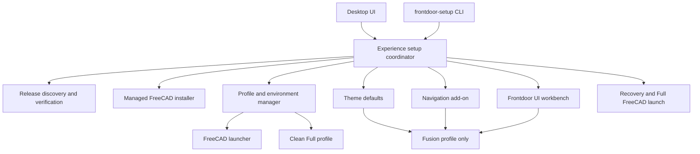

# Modular setup and runtime architecture

## Design goal

Keep installation, profile isolation, navigation, theme, Frontdoor UI, and launch responsibilities separate enough to test, repair, disable, and reason about independently. The setup coordinator orders those modules and reports outcomes; it does not absorb their implementation details.

## Proposed module boundaries

The diagram is the desired responsibility map, not a claim that each component already has an independent public API.

## Module responsibilities and boundaries

| Module | Owns | Must not own |
|---|---|---|
| Release discovery | Select official stable release, asset metadata, URL allowlist | Profile edits or UI decisions |
| Installer | Digest/signature checks and managed per-user FreeCAD installation | Existing FreeCAD directories or profiles |
| Profile manager | App data root, ownership markers, profile creation, launch environment | Theme, command layout, add-on behavior |
| Navigation | Stage/configure the pinned navigation add-on in Fusion profile | Theme or task UI preferences |
| Theme | Set initial FreeCAD theme in Fusion profile without replacing later choice | Navigation mappings or workbench registration |
| Frontdoor UI | Register workbench, capability checks, task surface, native command mapping | Installer/downloads or ordinary FreeCAD settings |
| Launcher | Start the selected executable with the selected profile environment | Setup/repair policy |
| Recovery | Disable or bypass Frontdoor UI and start clean Full FreeCAD | Delete user data or silently rewrite ordinary profile |
| Coordinator | Order stages, apply requested features, aggregate readiness and failures | Low-level download/extraction/Qt code |

## Coordinator contract

The coordinator should accept a request containing:

- FreeCAD executable and known/queried version.
- The app-owned profile root.
- Requested features (`theme`, `navigation`, `frontdoor_ui`, `full_profile`).
- Optional progress/cancellation reporting.

It returns a result containing the selected executable, profile paths, and per-feature readiness (`not_requested`, `ready`, `degraded`, or `failed`) with an actionable reason. Readiness must be based on files/configuration and compatibility checks, not on worker completion alone.

Operations must be repeatable. An update should replace only files bearing a valid Frontdoor ownership marker, use staging/atomic replacement where possible, preserve user-selected preferences, and retain enough state for repair. Errors in one optional experience feature should not prevent launching Full FreeCAD.

## Implemented source mapping

- `setup.py` currently coordinates `release.py`/`installer.py`, `paths.py`, `addon.py`, `theme.py`, `ui_addon.py`, and `window_state.py`.
- `launcher.py` applies the selected profile environment to a child FreeCAD process.
- `src/frontdoor/freecad_addon/FrontdoorUI` implements the in-process FreeCAD workbench and Solid command surface.
- `smoke.py` is a Linux/X11-only development harness, not a product installer component.

The current code does not yet expose the complete per-feature readiness contract above or independent in-app feature toggles. Treat that as an architecture target, not existing behavior.

## Dependency ordering

1. Discover and validate release metadata if installing a managed copy.
2. Verify and install FreeCAD if the managed executable is absent or an approved update is selected.
3. Create and validate profile ownership paths.
4. Stage requested add-ons into the Fusion profile only.
5. Set first-run defaults without overwriting existing profile choices.
6. Verify required files and command providers are available.
7. Launch with the selected profile's environment.

The Full FreeCAD profile must never receive the Fusion navigation add-on or Frontdoor UI as a side effect of setting up the Fusion profile.

